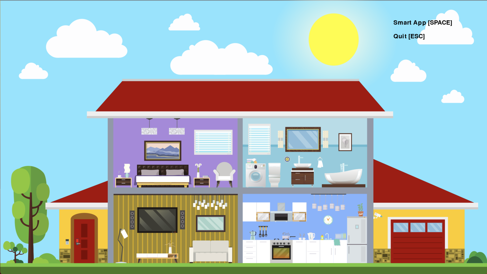
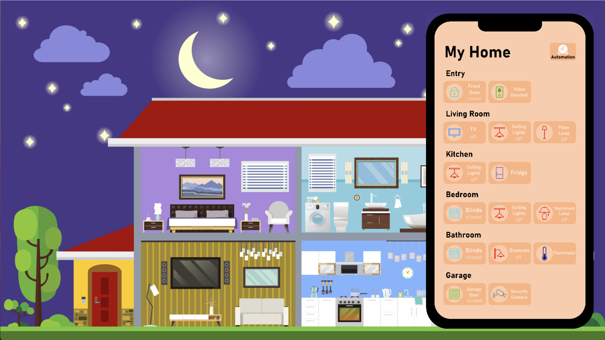

# 🏠 Smart Home Simulation

A 2D smart-home simulation built with Python and Pygame, inspired by home automation systems and cybernetics. The project simulates a connected house that can be controlled through an interactive, smartphone-style interface.

The application allows users to interact with different smart devices, manage household settings, receive notifications, and configure automated actions.

## ✨ Features

### 🏡 Interactive Smart Home

- Visual simulation of a house and its connected devices.
- Interactive, smartphone-style control interface.
- Control multiple devices and observe their states change in the simulation.

### 💡 Smart Devices
- 🪟 **Smart blinds** — Open and close blinds in different rooms.
- 💡 **Smart lighting** — Control ceiling lights, lamps, and bathroom lighting.
- 🚪 **Door control** — Simulate opening and closing the entrance and garage doors.
- 📺 **Smart television** — Switch between channels and adjust the volume.
- 🌡️ **Temperature controls** — Adjust simulated room temperatures and refrigerator/freezer settings.
- 📷 **Security camera** - Simulate home security monitoring.
- 🔔 **Doorbell** - Receive doorbell alerts.

### ⚙️ Automation
- Configure automated actions for connected devices.
- Manage automation rules through an interactive menu.
- Simulate a connected home in which devices respond to configured actions.

### 🔔 Notifications and Sound Effects
- Receive notifications about device interactions and household events.
- Simulate security alerts and unexpected events.
- Use sound effects to make interactions more immersive.

### 🌞 Day and Night Simulation
- Simulate different times of day, including morning, daytime, noon, and night.
- Include random household events to make the simulation more dynamic.

*Note: This is a software simulation. It does not connect to or control physical smart-home hardware.*

## 🖥️ User Interface

The application combines a graphical representation of a home with a smartphone-inspired interface for accessing device controls and automation menus.
### 🏠 Smart Home Overview


### 📱 Smartphone Interface




## 🛠️ Built With

- **Python** — Application logic and device behaviour
- **Pygame** — Graphics, event handling, animation, and audio playback
- **Object-oriented programming** — Separate classes for smart devices, buttons, notifications, and automation components

## 🚀 Getting Started

### Prerequisites

- Python 3
- `pip`, Python's package installer

### Installation

1. Clone the repository:

   ```bash
   git clone https://github.com/AndreVRibeiro/cibernetics-smart-home-simulation.git
   ```

2. Navigate to the application directory:

   ```bash
   cd cibernetics-smart-home-simulation/Code
   ```

3. Install the required Python packages:

   ```bash
   python -m pip install pygame playsound
   ```

### Run the Application

From the `Code` directory, run:

```bash
python main.py
```

**Controls**
- `Space` — Show the phone-interface to control the smart home
- `ESC` — Exit the application

## 🎯 Project Goals

This project explores the principles of cybernetics and home automation through an interactive simulation. It combines graphical programming, object-oriented design, device state management, and automation logic in a single application.

## 👨‍💻 My Contribution

This was a group project, and I was the main contributor to the software implementation.

My work focused on implementing and integrating the application's functionality. The repository preserves the commit history associated with my implementation.

## 📊 Project Presentation

The presentation used for the project can be viewed here:

[📑 View the project presentation](https://github.com/AndreVRibeiro/cibernetics-smart-home-simulation/blob/main/Norbert%20Wiener's%20Cybernetics%20-%20Presentation.pdf)

## 👥 Project Context

Developed as an academic group project (Seminar: Albert Wiener's Cybernetics, University of Basel 2023) exploring smart-home interactions and automation concepts.

---

*Created with Python, Pygame, and a passion for building interactive software.* 🏡
